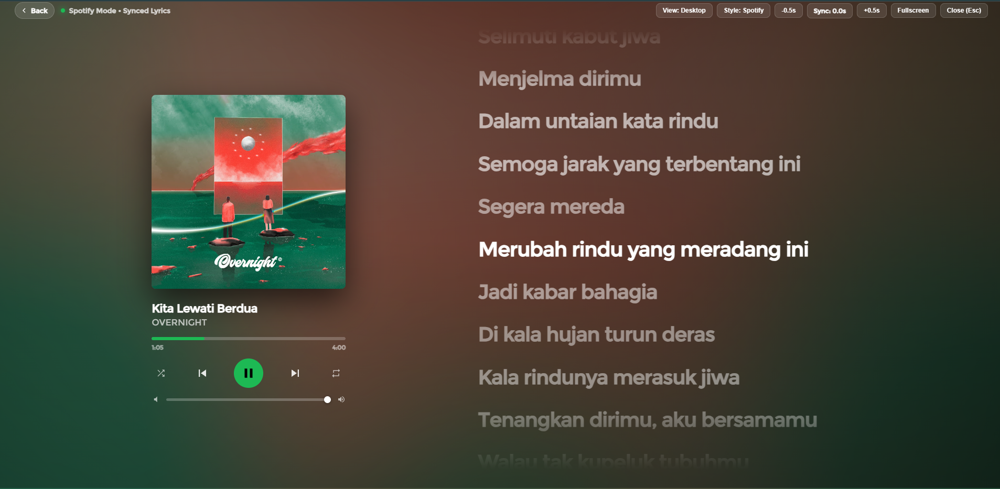

<div align="center">
  

  <h1>YTM Studio</h1>

  <p>
    <strong>Apple Music &amp; Spotify Themes, Real-Time Synced Lyrics, and MV3 Adblock for YouTube Music.</strong>
  </p>

  <p>
    
    
    
    
    
  </p>

  <p>
    <a href="#-features">Features</a> •
    <a href="#-installation">Installation</a> •
    <a href="#-configuration">Configuration</a> •
    <a href="#-keyboard-shortcuts">Shortcuts</a> •
    <a href="#-development--build">Build</a> •
    <a href="#-privacy--permissions">Privacy</a>
  </p>
</div>

---

<div align="center">
  
</div>

---

## ✨ Features

### 🎨 Switchable Appearances (1-Click)
- **Apple Music Mode** — Frosted acrylic glass surfaces, alternating track rows, LCD-style center Now Playing pill, dynamic 4-orb Mesh Gradient sampled from album artwork, and blurred karaoke-sweep lyrics.
- **Spotify Mode** — Pure black `#000000` sidebar, `#121212` canvas, `#1DB954` Spotify Green accents, circular green Play/Pause button, and crisp unblurred bold lyrics.

### 🎵 Real-Time Synced Lyrics
- Automatically fetches time-synced `.lrc` lyrics from [LRCLIB](https://lrclib.net/) with zero API keys or sign-in required.
- 60fps synchronization tied directly to the `<video>` element with smooth auto-centering scroll and a 3-dot pulsing instrumental interlude indicator.
- **Click-to-seek:** Click any lyric line to jump straight to that timestamp.
- **Live Sync Offset (`-0.5s` / `+0.5s`):** Compensate for music videos with longer intros than album tracks.
- **One-click Back Navigation (`‹ Back`):** Exit full-screen lyrics cleanly like a native app.

### 🛡️ 3-Layer MV3 Adblock & Auto-Skip
- **Network Layer:** Static `declarativeNetRequest` rules (`rules/adblock.json`) block YouTube Music ad and tracking endpoints.
- **Player Payload Pruning:** `MAIN`-world scriptlet (`adblock-main.js`) strips `adPlacements`, `playerAds`, and `adSlots` from `/youtubei/v1/player` JSON responses.
- **Cosmetic & Auto-Skip Fallback:** Hides promo banners/dialogs and automatically mutes, fast-forwards, and skips any server-side ad stream.

---

## 📦 Installation

### Chrome / Edge / Brave (Developer Mode)
1. Download or clone this repository.
2. Open `chrome://extensions/` (or `edge://extensions/`, `brave://extensions/`).
3. Enable **Developer mode** in the top-right corner.
4. Click **Load unpacked** and select the `ytm-studio-ext` directory.

### Firefox (128+)
1. Run `bash build.sh` to generate `dist/ytm-studio-firefox-v1.3.0.xpi`.
2. Open `about:debugging#/runtime/this-firefox`.
3. Click **Load Temporary Add-on...** and select `dist/ytm-studio-firefox-v1.3.0.xpi`.

### Standalone Web Preview (No Extension Install)
Want to try the UI and live LRCLIB sync before installing? Open `../ytm-studio-preview/index.html` in any browser, or run:

```bash
python -m http.server 8080 --directory ../ytm-studio-preview
```

---

## ⚙️ Configuration

Click the **YTM Studio** toolbar icon while on `https://music.youtube.com` to toggle any setting live (applied immediately via direct tab messaging):

| Setting | Default | Description |
| --- | :---: | --- |
| **Appearance Style** | `Apple Music` | Switch between `Apple Music` and `Spotify` styling across both the main page and full-screen Lyrics overlay. |
| **Enable Custom Theme** | `ON` | Apply the selected theme to the main YouTube Music layout. Turn `OFF` to keep YouTube Music's default page UI while keeping Synced Lyrics and Adblock active. |
| **Animated Blur Background** | `ON` | Enable the animated 4-orb Mesh Gradient behind the Apple Music Lyrics overlay. Turn `OFF` for lower GPU usage. |
| **Lyrics Button in Player Bar** | `ON` | Show or hide the **Lyrics** pill button in the bottom-right player bar (`L` shortcut still works when hidden). |
| **Adblock & Auto-Skip Ads** | `ON` | Toggle all 3 adblock layers (`declarativeNetRequest` ruleset, JSON pruning, cosmetic hiding, and auto-skip). |

---

## ⌨️ Keyboard Shortcuts

| Key / Control | Action |
| --- | --- |
| `L` or **Lyrics** button | Open / close Full-Screen Synced Lyrics |
| `Esc` or **`‹ Back`** | Close Full-Screen Synced Lyrics |
| **`Style: ...`** (top bar) | Switch between Apple Music and Spotify live |
| **`-0.5s`** / **`+0.5s`** | Shift lyric sync timing earlier or later |
| Click any lyric line | Seek playback directly to that line |
| Mouse wheel in lyrics | Temporarily pause auto-scroll (~4.5s) to browse freely |

---

## 🛠️ Development & Build

### Prerequisites
- **Python 3** (for manifest generation and cross-platform packaging)
- **Node.js** *(optional — used for `node --check` syntax validation)*

### Run Unit Tests
Uses Node.js's built-in test runner (no `npm install` required):

```bash
node --test tests/extension.test.js
```

### Build Packages
```bash
bash build.sh
```

Generates clean browser-specific archives in `dist/`:
- `dist/ytm-studio-chrome-v1.3.0.zip` — Chrome / Edge / Brave MV3 (`service_worker`)
- `dist/ytm-studio-firefox-v1.3.0.xpi` — Firefox 128+ MV3 (`background.scripts` + `gecko`)

### Project Structure

```text
ytm-studio-ext/
├── manifest.json          # Base MV3 manifest (Chrome-ready)
├── background.js          # LRCLIB lyrics fetcher & DNR ruleset sync
├── adblock-main.js        # MAIN-world JSON-prune scriptlet (/youtubei/v1/player)
├── content.js             # Track observer, 60fps synced lyrics, & ad auto-skipper
├── styles.css             # Apple Music & Spotify themes + Full-Screen Lyrics UI
├── popup.html             # Extension settings popup markup
├── popup.js               # Settings persistence & live tab broadcast
├── rules/
│   └── adblock.json       # Static declarativeNetRequest block rules
├── icons/                 # Extension toolbar icons (16, 48, 128px)
├── docs/
│   ├── logo.svg           # Project vector logo
│   └── preview.png        # UI screenshot
├── tests/
│   └── extension.test.js  # Zero-dependency Node.js unit test suite
└── build.sh               # Cross-browser build & validation script
```

---

## 🔒 Privacy & Permissions

YTM Studio does **not** collect analytics, telemetry, or personal user data.

| Permission | Purpose |
| --- | --- |
| `storage` | Save your theme, style, animation, and adblock preferences locally. |
| `declarativeNetRequest` | Block YouTube Music ad and tracking endpoints locally via static rules. |
| `https://music.youtube.com/*` | Inject themes, synced lyrics overlay, and adblock on YouTube Music only. |
| `https://lrclib.net/*` | Fetch synced lyrics by track title, artist, album, and duration. |

---

## ❓ Troubleshooting

- **Toggles don't apply after reloading the extension?** Click the **Refresh YouTube Music Tab** button inside the popup (or press `F5` on `music.youtube.com`) to reconnect the content script.
- **Lyrics slightly early or late?** Click **`-0.5s`** or **`+0.5s`** in the top bar; the offset resets automatically on the next song.
- **No lyrics found for a remix/cover?** LRCLIB matches standard studio titles (`Artist - Title`) best.

---

## 📄 License

Distributed under the **MIT License**. This project is an independent open-source extension and is not affiliated with Google, YouTube, Apple, or Spotify.
